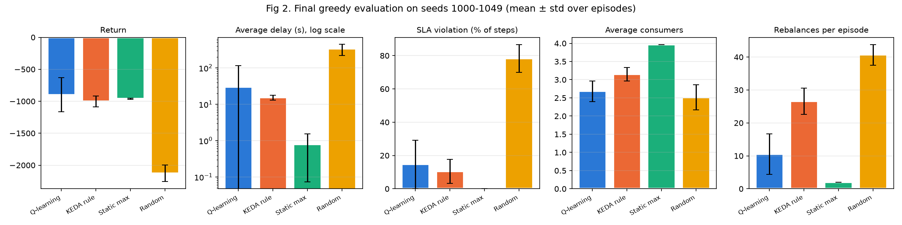
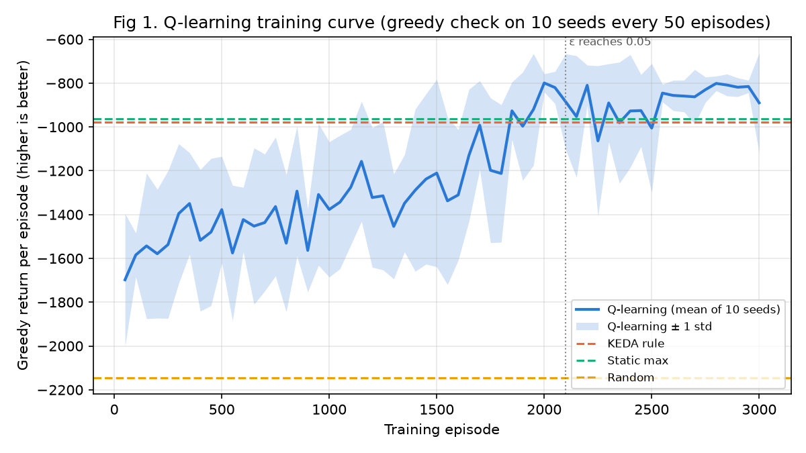
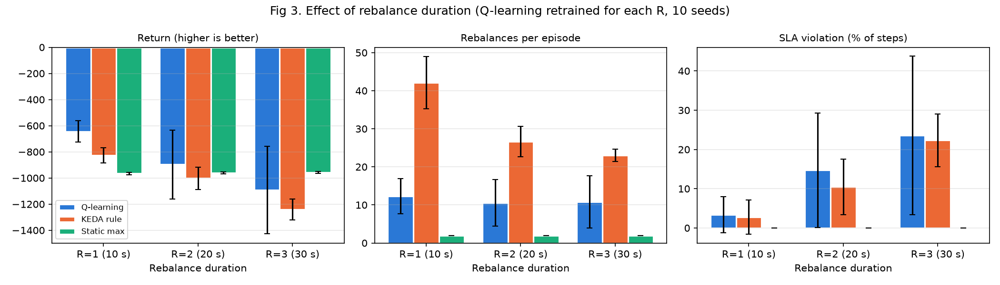
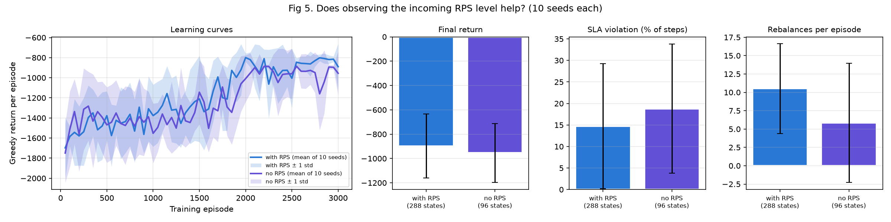
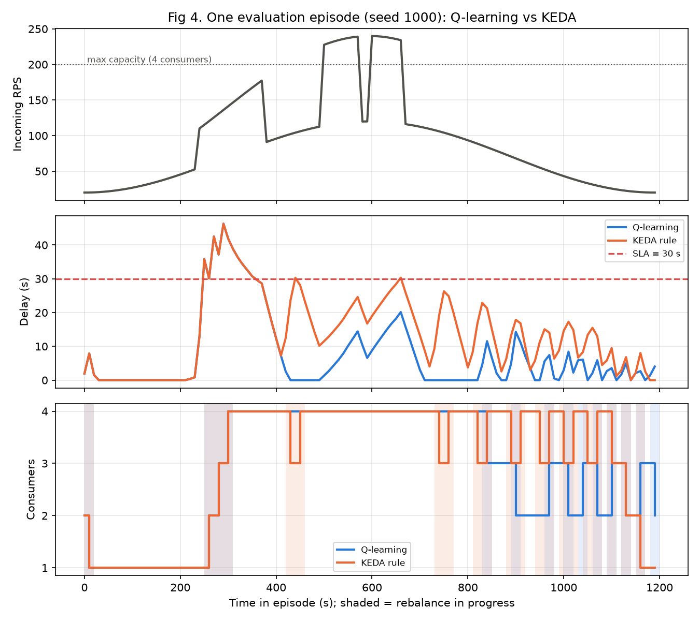
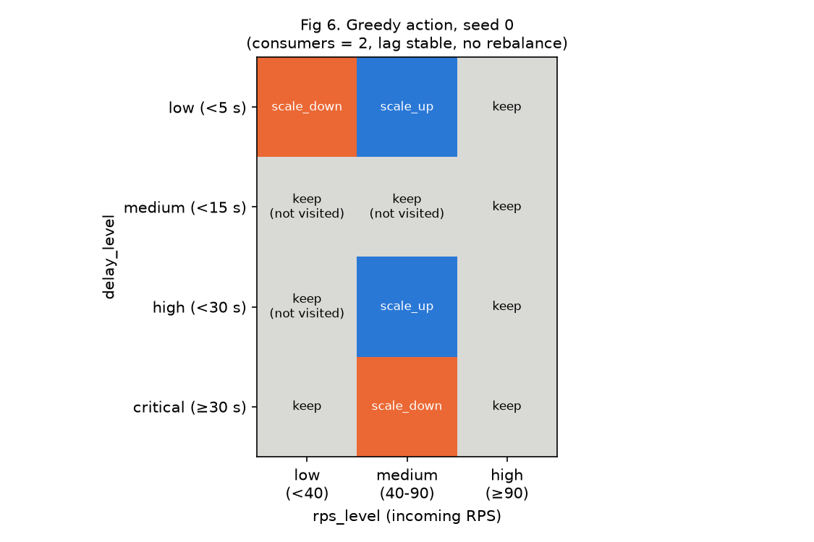

# LagPilot: learning when to scale Kafka consumers

**CSCI3235 Reinforcement Learning, Midterm I** · Author: Aliyev Nurislam

LagPilot is a small reinforcement learning (RL) project. A **Q-learning agent**
learns how many workers ("consumers") should read orders from a message queue
(Apache Kafka) when traffic goes up and down. It is compared with the rule that
real Kubernetes clusters use today (**KEDA**).

> New to Kafka or RL? Read **[THEORY.md](THEORY.md)** first. It explains every
> idea used here from zero: Kafka, consumer lag, rebalances, Little's Law,
> KEDA, MDPs and Q-learning, with small worked examples.

---

## Contents

1. [The problem in plain words](#1-the-problem-in-plain-words)
2. [How the project works](#2-how-the-project-works)
3. [Quick start](#3-quick-start)
4. [Results](#4-results)
5. [Project structure](#5-project-structure)
6. [Reproducibility: seeds and frozen config](#6-reproducibility-seeds-and-frozen-config)
7. [Live Kafka demo (optional)](#7-live-kafka-demo-optional)
8. [Limitations](#8-limitations)

---

## 1. The problem in plain words

An online shop gets orders. Every order is put into a **queue** (a Kafka topic).
A group of **workers** (Kafka consumers) takes orders from the queue and
processes them.

- **Traffic changes during the day.** It is quiet at night (about 20 orders per
  second), busy at midday (about 120 orders per second), and sometimes there is a
  **flash sale**: traffic suddenly doubles for 1–3 minutes.
- **Too few workers:** orders pile up in the queue. This pile is called
  **lag**. If an order waits more than **30 seconds**, we break our promise to
  the customer (the **SLA**).
- **Too many workers:** we pay for servers that do nothing.
- **The tricky part: changing the number of workers is not free.** In Kafka,
  every time a worker joins or leaves, the group does a **rebalance**: it
  re-divides the work. During this time (here 20 seconds) **nobody processes
  anything**, and the queue grows.

So the question is not only "how many workers do I need now?" but also **"is it
worth paying a rebalance to change the count right now?"** A simple rule cannot
weigh this trade-off. An RL agent can learn it from experience.

**The standard rule (KEDA)** looks only at the lag:
`workers = ceil(lag / 500)`. It reacts fast but does not care about the
rebalance cost, so it often adds and removes workers again and again
("flapping").

**Quick capacity check.** One worker handles 50 orders/s. At the peak,
120 / 50 = 2.4, so we need at least 3 workers at midday and 1 worker at night.
A flash sale at the peak gives 240 orders/s, but the maximum is
4 × 50 = 200/s. **No policy can avoid lag during a big spike.** The agent can
only manage it well.

---

## 2. How the project works

```
                ┌───────────────────────────────────────────────┐
                │  Simulator  (lagpilot/env.py)                 │
                │  - traffic: daily curve + random flash sales  │
 action         │  - queue (lag), 1..4 consumers                │   state, reward
 keep / +1 / -1 │  - rebalance stops processing for 20 s        │ ─────────────────┐
 ───────────────►  - delay = lag / (consumers × 50)  (Little)   │                  │
 ▲              └───────────────────────────────────────────────┘                  │
 │                                                                                 ▼
 │              ┌───────────────────────────────────────────────┐
 └──────────────┤  Agent  (lagpilot/agents.py)                  │◄─────────────────┘
                │  Q-table 288 states × 3 actions               │
                │  learns: Q(s,a) ← Q + α [r + γ max Q(s') − Q] │
                └───────────────────────────────────────────────┘
```

**One step = 10 seconds. One episode = 120 steps = one compressed "day".**

| MDP part | What it is here |
|---|---|
| **State** (what the agent sees) | delay level (low / medium / high / critical), lag trend (falling / stable / rising), incoming traffic level (low / medium / high), number of consumers (1–4), is a rebalance running (yes / no) → 4×3×3×4×2 = **288 states** |
| **Actions** | `keep`, `scale_up` (+1 consumer), `scale_down` (−1 consumer) |
| **Reward** (per step, negative = cost) | `−( delay/10 + 2 × consumers + 5 × [delay > 30 s] )` → pay for waiting orders, for servers, and extra for SLA breaks |
| **Transitions** | random: orders arrive as a Poisson process; flash sales start at random |
| **Start** | 2 consumers, empty queue |
| **Horizon / discount** | 120 steps, γ = 0.95 |

**Policies we compare:**

| Policy | What it does |
|---|---|
| **Q-learning** (ours) | learns from 3000 simulated days which action is best in each state |
| **KEDA rule** | `desired = clip(ceil(lag / 500), 1, 4)`, moves one step toward it |
| **Static max** | always runs 4 consumers (safe but expensive) |
| **Random** | random actions (lower bound) |

The whole flow of the experiment:

1. Train **10 agents** with different random seeds (0–9), 3000 episodes each.
2. Every 50 episodes, check the agent greedily (no exploration) → learning curve.
3. After training, evaluate every policy on **50 new days** (seeds 1000–1049)
   that were never used in training.
4. Repeat training with rebalance duration R = 10 s / 20 s / 30 s (parameter study).
5. Repeat training **without** the traffic-level feature (96 states) to test
   what this information is worth.

---

## 3. Quick start

**Requirements:** Python 3.12 (tested 3.12.15 on macOS), about 2 minutes of CPU.

```bash
# 1. go to the project folder
cd lagpilot

# 2. create and activate a virtual environment
python3 -m venv .venv
source .venv/bin/activate          # Windows: .venv\Scripts\activate

# 3. install dependencies (numpy, pandas, matplotlib only)
pip install -r requirements.txt

# 4. run everything
python -m lagpilot.experiments
```

**Expected output** (shortened):

```
Training Q-learning (default config, 288 states) ...
    policy  return_mean  return_std  avg_delay_s_mean  sla_violation_pct_mean  avg_consumers_mean  rebalances_mean
Q-learning      -897.42      264.19             30.10                   14.71                2.68            10.51
 KEDA rule     -1002.59       84.93             15.28                   10.47                3.15            26.62
Static max      -961.52        8.65              0.79                    0.00                3.97             2.00
    Random     -2126.73      129.22            332.90                   78.27                2.51            40.66
Rebalance study: R = 1 ...
Rebalance study: R = 2 ...
Rebalance study: R = 3 ...
Training Q-learning without rps_level (96 states) ...
Done. Results in .../results
Total runtime: 120.8 s
```

All figures and CSV files are written to `results/`. The run is **deterministic**:
if you delete `results/` and run again, you get exactly the same numbers.

**Quick sanity check** (baselines only, a few seconds):

```bash
python -m lagpilot.train
```

---

## 4. Results

All numbers below come from the CSV files in `results/`. Return = sum of
rewards over one day; **higher (closer to 0) is better**.

### 4.1 Final comparison (default setting, rebalance = 20 s)

| Policy | Return ↑ | Avg delay (s) ↓ | SLA broken (% of steps) ↓ | Avg consumers ↓ | Rebalances per day ↓ |
|---|---|---|---|---|---|
| **Q-learning** (10 seeds × 50 days) | **−897.4 ± 264.2** | 30.1 ± 84.0 | 14.7 ± 14.6 | **2.68** | 10.5 |
| KEDA rule | −1002.6 ± 84.9 | 15.3 ± 2.3 | 10.5 ± 7.1 | 3.15 | 26.6 |
| Static max (always 4) | −961.5 ± 8.7 | **0.8** | **0.0** | 3.97 | 2.0 |
| Random | −2126.7 ± 129.2 | 332.9 | 78.3 | 2.51 | 40.7 |



**What this means:**

- On average Q-learning has the **best return**. It uses fewer servers than KEDA
  (2.68 vs 3.15) and makes **2.5× fewer rebalances** (10.5 vs 26.6).
- It breaks the SLA **more often** than KEDA (14.7% vs 10.5% of steps). It
  accepts some delay to save servers, because the reward tells it to.
- **9 of 10 trained agents** beat both baselines (per-seed returns −874.8 to
  −772.7). **One agent (seed 2) failed** (−1537.8, average delay 219.6 s). This
  single seed causes the large ± value. Median of the 10 agents: −829.7.

### 4.2 Learning curve



The agent improves from about −1698 to about −800 by episode 2000 and then
stays above both baselines on average. After exploration ends (ε = 0.05 at
episode 2100) the curve is **not fully stable**: some seeds change their greedy
policy and the mean drops at some checkpoints.

### 4.3 Parameter study: how expensive is a rebalance?

| Rebalance time R | Q-learning | KEDA | Static max | Q rebalances | KEDA rebalances | Q seeds better than KEDA / static |
|---|---|---|---|---|---|---|
| 10 s | **−643.4** | −826.9 | −966.5 | 12.3 | 42.1 | 10 / 10 |
| 20 s | **−897.4** | −1002.6 | −961.5 | 10.5 | 26.6 | 9 / 9 |
| 30 s | −1092.7 | −1239.7 | **−957.3** | 10.8 | 23.1 | 8 / 4 |



- KEDA gets much worse when rebalances are slower, because it keeps flapping.
- Q-learning beats KEDA at every R.
- **Honest negative result:** at R = 30 s, simply running 4 consumers all the
  time (static max) is best on average. Only 4 of 10 Q-learning agents beat it.
  The agent did not reliably learn "when rebalances are very expensive, don't
  scale at all".

### 4.4 Does seeing the traffic level help?

| Agent | Return | Median of 10 agents | SLA broken (%) | Rebalances |
|---|---|---|---|---|
| with traffic level (288 states) | −897.4 ± 264.2 | **−829.7** | **14.7** | 10.5 |
| without traffic level (96 states) | −953.5 ± 241.8 | −876.1 | 18.8 | 5.8 |



Without the traffic level the agent only sees the *result* of traffic (delay),
not its *cause*, so it reacts later and breaks the SLA more often. With it, the
agent can add a consumer **before** the delay becomes critical.

### 4.5 One day in detail



Top: incoming traffic. Middle: delay with the 30 s SLA line. Bottom: number of
consumers (shaded = rebalance in progress). KEDA (orange) keeps removing and
re-adding a consumer; every change stops processing for 20 s. In this day,
Q-learning made 14 rebalances and broke the SLA in 11 steps; KEDA made 21
rebalances and broke the SLA in 13 steps.

### 4.6 What the agent learned



The greedy action for 2 consumers, stable lag, no rebalance. Some cells look
wrong (for example *scale_down* when delay is critical). These states are rarely
visited, so their Q-values are based on few, noisy samples. This is a known
weakness of tabular Q-learning.

---

## 5. Project structure

```
lagpilot/
├── lagpilot/                 # the RL code (NumPy only, no Gym)
│   ├── config.py             # all constants in one place (frozen)
│   ├── env.py                # KafkaLagEnv: the simulator (reset, step, encode, decode)
│   ├── agents.py             # QLearningAgent, KedaRulePolicy, StaticMaxPolicy, RandomPolicy
│   ├── train.py              # run_episode, evaluate, train_seed (+ baseline sanity check)
│   └── experiments.py        # runs all experiments, saves figures and CSVs
├── results/                  # generated: fig1..fig6 (.png), CSVs, q_table.npy, transition_example.json
├── report/
│   ├── report.md / .pdf      # the 6-page report
│   └── learning_record.md    # learning record
├── demo/                     # optional live Kafka demo (see demo/README.md)
├── README.md                 # this file
├── THEORY.md                 # all background theory from zero
└── requirements.txt          # numpy, pandas, matplotlib (pinned)
```

**Where to look in the code:**

| I want to see… | Open |
|---|---|
| the Q-learning update rule | `lagpilot/agents.py` → `QLearningAgent.update` (every term is commented) |
| one simulator step | `lagpilot/env.py` → `KafkaLagEnv.step` (6 numbered parts) |
| how the state is built | `lagpilot/env.py` → `_features`, `encode`, `decode` |
| the KEDA rule | `lagpilot/agents.py` → `KedaRulePolicy.act` |
| the training loop and ε decay | `lagpilot/train.py` → `train_seed` |

**Generated result files:**

| File | Content |
|---|---|
| `table_final.csv` | main comparison table (4.1) |
| `table_q_per_seed.csv` | result of each of the 10 Q-learning agents |
| `eval_episodes.csv` | every evaluation day of every policy (raw data) |
| `fig1_training_curve.csv`, `fig1_baselines.csv` | learning curve data |
| `fig3_rebalance_study.csv`, `fig3_q_per_seed.csv` | parameter study |
| `fig4_episode_trace.csv` | step-by-step log of the day in 4.5 |
| `fig5_rps_feature.csv`, `fig5_q_per_seed.csv`, `fig5_rps_feature_curves.csv` | traffic-feature study |
| `fig6_policy_heatmap.csv` | policy heatmap data |
| `q_table.npy` | learned Q-table (seed 0), used by the demo |
| `transition_example.json` | one real step: state, action, reward, next state, raw numbers |

---

## 6. Reproducibility: seeds and frozen config

| What | Seeds |
|---|---|
| Training (one agent per seed) | 0–9 |
| Training day `e` of seed `s` | `10_000_000 + s × 100_000 + e` |
| Greedy checks during training | 2000–2009 |
| Final evaluation (greedy, no learning) | 1000–1049 |
| One-time config tuning (baselines only) | 5000–5039 |

**Frozen configuration** (`lagpilot/config.py`):

| Group | Parameter | Value |
|---|---|---|
| Time | step / episode | 10 s / 120 steps (20 min) |
| Traffic | base RPS | 20 at the ends, 120 at the peak, `sin²` shape |
| | flash sale | starts with p = 0.04 per step, lasts 5–15 steps, × 2.0 |
| | arrivals per step | Poisson(RPS × 10) |
| Consumers | partitions / consumers | 4 / 1–4, start with 2 |
| | throughput per consumer μ | 50 msg/s |
| | rebalance duration R | 2 steps (20 s) |
| SLA | max delay | 30 s |
| Reward | w_delay, w_cons, w_sla | 1.0, 2.0, 5.0 (delay capped at 120 s) |
| State | delay edges / RPS edges | 5, 15, 30 s / 40, 90 RPS |
| | lag-trend dead-band | max(5% of previous lag, 100 msgs) |
| KEDA rule | lag threshold | 500 msgs per consumer |
| Q-learning | α, γ | 0.1, 0.95 |
| | ε | 1.0 → 0.05, linear over the first 70% of episodes |
| | training | 3000 episodes per seed |

**Honesty rule.** The config was tuned **once**, using **only the baselines**,
before any Q-learning run, so that the problem is not trivial (1 consumer fails
at the peak, 4 are enough but expensive, spikes hurt). Changes from the first
draft: μ 40 → 50, spike × 2.5 → × 2.0, w_cons 1 → 2, traffic shape sin → sin²,
KEDA threshold 1000 → 500 (the best of 250/500/1000/2000 for KEDA itself). With
the first draft, even 4 consumers broke the SLA in about 30% of steps, so
"always run 4" was trivially best. The config was then frozen and never changed
to help Q-learning.

---

## 7. Live Kafka demo (optional)

`demo/` runs the trained Q-table against a **real** Kafka broker in Docker: a
FastAPI endpoint receives orders, a load generator sends 20 → 120 → 300 RPS,
real consumer threads process them, and every 10 s the agent reads the real lag
and adds or removes a consumer (a real rebalance). See
[demo/README.md](demo/README.md) for the 4 commands.

> **The demo only shows the trained policy running on real Kafka. All results
> above come from the simulator.**

| Simulator | Real Kafka |
|---|---|
| arrivals, RPS | producer rate (broker metric `MessagesInPerSec`) |
| lag | Σ over partitions of (log end offset − committed offset) |
| consumers 1–4 | consumer instances in one group (a 5th would be idle with 4 partitions) |
| rebalance, processing = 0 | eager (stop-the-world) group rebalance |
| delay = lag / (c × μ) | time to drain the backlog (Little's Law) |

---

## 8. Limitations

- **Simplified state:** delay is put into 4 buckets, so 31 s and 300 s look the
  same; there is no time-of-day feature. The state is only approximately Markov.
- **Eager rebalance model:** modern Kafka has cooperative incremental
  rebalancing (KIP-429), which is much cheaper.
- **KEDA without cooldown:** real KEDA/HPA has stabilization windows that reduce
  flapping. Our rule has none, which favours Q-learning.
- **Unstable seeds:** 1 of 10 agents failed; the learning curve can drop after
  exploration ends.
- **Simulator gap:** real consumers have variable speed, rebalances have random
  length, and traffic is not a clean curve.

More details and next steps are in the report: [report/report.pdf](report/report.pdf).
